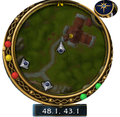

# Vanilla Remastered UI

**Nineteen addons that come built into every Open Vanilla client.** Nothing to download, no folders to copy. Many replace an addon Vanilla players already know, plus Open Vanilla originals.

## The suite

| Addon | Like | What it does |
|---|---|---|
| Bags | Bagnon | All bags in one, search, and your bank remembered |
| Meters | Details!, Recount | Damage and healing for you, your group and pets |
| Quests | Questie | Map ring, compass rose, coordinates and quest pins |
| Threat | KTM | Threat meter (with the realm's data) |
| Casting | ClassicCastbars | Enemy cast bars |
| Plates | | Restyled nameplates and target debuffs |
| Prices | Auctioneer | Auction prices you've seen, plus realm medians |
| Vendor | SellJunk | Sells greys and repairs |
| Guilds, Raid, Persona | | Guild listings, raid markers and pull timer, roleplay profiles |
| Social, Dungeons, Achievements, Chat, Mail, Loot, Talents, Essentials | | Friends and group finder, achievements (points only, never power), a readable chat, mail helpers, loot list, talent specs and planner, and helpers on your map |

Plus **Transmog**, **Warfront**, the **Assistant** (`/assistant`) and **Herald** in game, all on the shared core `WenillaCore`. `/addons` opens the settings; `/vanilla` switches to pure 1.12.

## Install

They're already in every Open Vanilla client and the browser client. On a stock 1.12 client, copy `Data/Interface/AddOns/*` into your game's `Interface/AddOns`. Features that need realm data (quest pins, threat, prices) light up on realms with the Open Vanilla server hook.

## Workshop

`workshop/catalog/` lists community addons for 1.12 with how well each works; `tools/workshop_*.py` builds the Workshop index the launcher and website read.

Details: [docs/CLASSIC_PLUS_ADDONS.md](docs/CLASSIC_PLUS_ADDONS.md). Test every addon in seconds with the Lua sim in [openvanilla-devkit](https://github.com/orionopenwow/openvanilla-devkit).

## Part of Open Vanilla

[Open Vanilla](https://github.com/orionopenwow/OpenVanilla) is a free, open-source, community-built Vanilla project ([openvanilla.app](https://openvanilla.app/), [Discord](https://discord.gg/r6nj5p8U4)). Its products:

- [Vanilla Forge](https://github.com/orionopenwow/vanilla-forge): The Open Vanilla creator app: maps, models, creatures, quests, items and addons, tested in a copy of your game and published as a signed pack.
- [Vanilla Agents](https://github.com/orionopenwow/vanilla-agents): Your AI coding helpers as heroes in a cosy inn: you roam, they work, a checker verifies every quest.
- [Herald](https://github.com/orionopenwow/herald): The Open Vanilla Discord bot, the in-game World chat bridge, and Herald Autopilot: he plays a character for you, simulates gear and learns from play.
- [Open Vanilla Server](https://github.com/orionopenwow/openvanilla-server): Everything that runs a realm: the realm images and CMaNGOS patches, the web/asset service, Server Studio, Play Solo packs, the relay, and the turnkey Hetzner deployment.
- [Open Vanilla Launcher](https://github.com/orionopenwow/openvanilla-launcher): OpenVanilla.exe: play online, solo or in the browser, the Workshop, signed updates and live news; plus the release packaging.
- [Vanilla Remastered UI](https://github.com/orionopenwow/vanilla-remastered-ui) (this one): The in-game addon suite (WenillaCore, Quests, Transmog, Achievements, Guilds and the rest), Classic+ data, and the Workshop addon catalog.
- [openvanilla.app](https://github.com/orionopenwow/openvanilla-site): The Open Vanilla website (GitHub Pages) and the player manual.
- [Open Vanilla Devkit](https://github.com/orionopenwow/openvanilla-devkit): Test a change in seconds on your PC, try it against the live realm, and let a staging realm prove it first; plus the project's checks and tests.
- [Open Vanilla Agent Kit](https://github.com/orionopenwow/openvanilla-agent-kit): Let an AI coding agent change your copy of Open Vanilla for you: addons, interface, your own realm's rates and NPCs.
- [Open Vanilla Art & Tools](https://github.com/orionopenwow/openvanilla-art-tools): Art sources, UI kits and the generator scripts behind the launcher, site and addon artwork; plus the project's maintenance tools.

## License

MIT: see [LICENSE](LICENSE). Addons listed in `workshop/catalog/` belong to their own authors; the catalog only describes them.

## About this repository

This repository is published from **Open Vanilla** (commit `e11f02fd65`: duels_up.sh: put back Duels Lite and everything 4e717e7 overwrote; keep only its combos.json mount). Changes are made there and arrive here with each release, so please open issues and pull requests on [Open Vanilla](https://github.com/orionopenwow/OpenVanilla/issues).

World of Warcraft is a trademark of Blizzard Entertainment, Inc. Open Vanilla is an independent fan project, not affiliated with or endorsed by Blizzard Entertainment. No Blizzard game files are included: you need your own.
